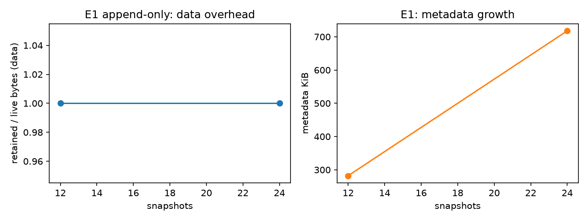
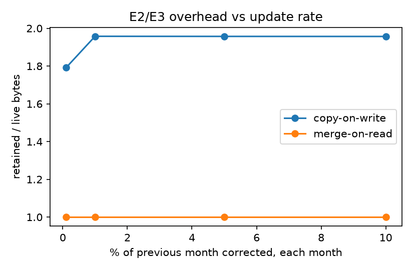
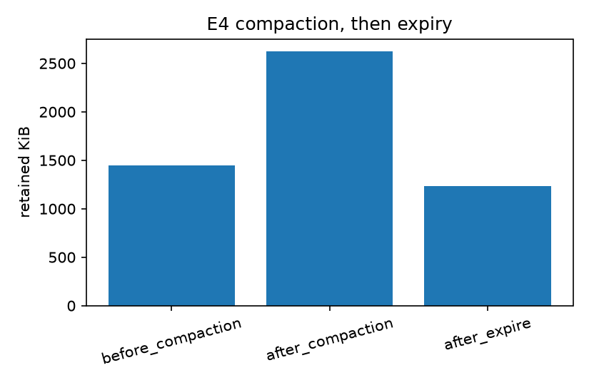
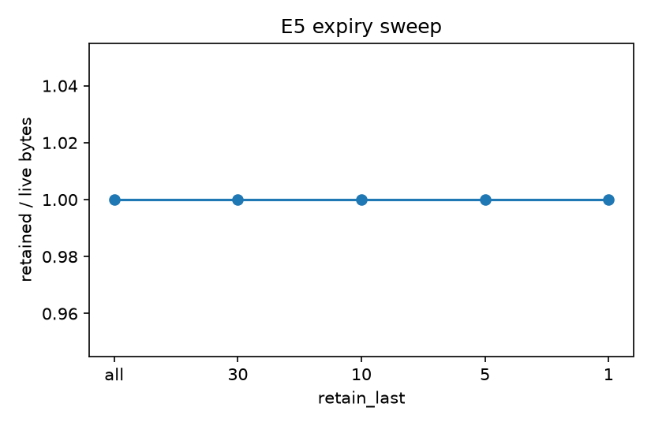
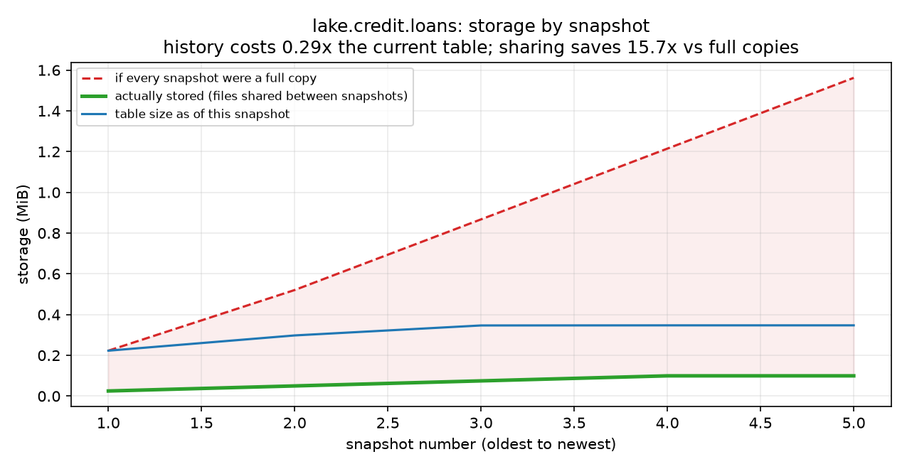
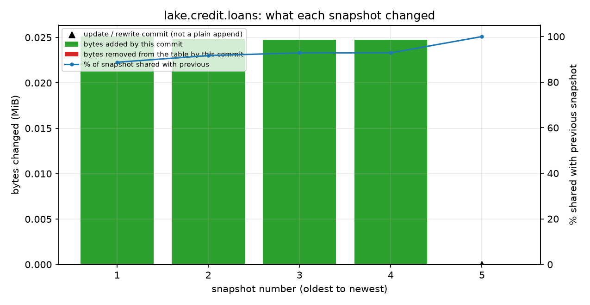
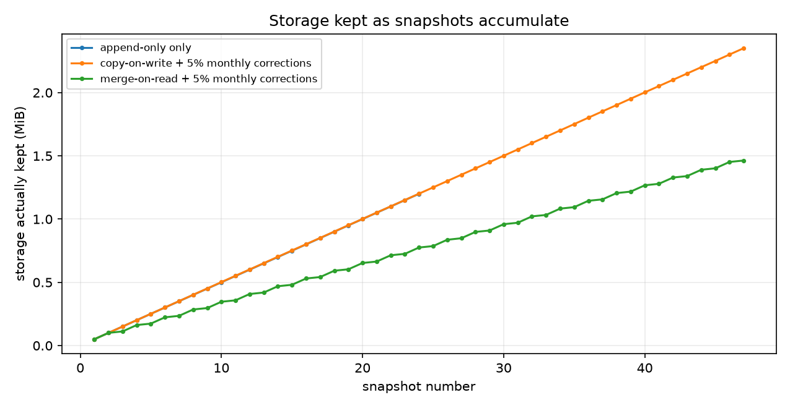

# Audit-Readiness Report: Time Travel for Reproducible ML

*Generated from run evidence. Items marked TEAM TO COMPLETE need human judgement. Nothing here is invented: if an evidence file was missing, the section says NOT RUN.*

> **NOTE: the demo evidence in sections 4, 5 and 7 was generated on SYNTHETIC data. It shows the machinery works; rerun on your real dataset (`bash run.sh`, option 5) before submitting.**

## 1. Scope and control summary

A credit-default model is trained on loan data held in an Apache Iceberg table. The question an auditor asks is: *which exact data was this model trained on, and can you prove you can rebuild it?* The controls below answer it.

| Control | What it proves | Test result |
|---|---|---|
| T1 | Every model version is bound to an Iceberg snapshot ID | PASS |
| T2 | Exact retrain from the registry after the table has changed | PASS |
| T3 | Time travel returns the data as it was | PASS |
| T4 | Rollback restores the known-good state; tainted models quarantined | PASS |
| T5 | Retention preserves audit evidence and refuses unsafe cleanup | PASS |
| T6 | Negative control: the test can fail (unpinned retrain differs) | PASS |

Test results come from `pytest --junitxml=reports/junit.xml`. SKIPPED means the Iceberg tests were not run in that environment; the report is not audit-ready until they pass.

## 2. Data and data card

### Data card: LendingClub accepted loans (TEAM TO COMPLETE every field marked TODO)

- **Source:** Kaggle "Lending Club" accepted-loans file. TODO: exact dataset URL, version/date downloaded, file SHA-256 (the ingest log records the SHA-256 of the file actually loaded).
- **Licence / access terms:** TODO: copy from the Kaggle dataset page at download time.
- **Rows used:** TODO: months loaded (see `data.start_month`/`end_month` in `conf/pipeline.yaml`), rows after cleaning (see `ingest_log`).
- **Target:** `loan_status` Fully Paid -> 0, Charged Off -> 1 (including the "Does not meet the credit policy" variants). Loans still current, late, in grace period or defaulted-but-not-charged-off have no final outcome and are dropped.
- **Features used:** the allow-list in `conf/features_allowlist.txt` (hash recorded in every registry row). Origination-time fields only.
- **Excluded on purpose:** post-origination fields (total payments, recoveries, last payment date, last credit pull, outstanding principal) because they leak the outcome; `addr_state` and `zip_code` as geographic proxies.
- **Known limitations:** historical data from one lender, selection bias (only approved loans), label timing (recent loans are mostly unresolved), not validated for real lending decisions. TODO: add anything you found.
- **Sensitive data:** do not attempt to re-identify borrowers.
- **Development runs** may use synthetic data from `ttml gen-data`, which is not statistically realistic. Say which data each reported result used.

## 3. Lineage design

- Source CSV is split into calendar months. Each month is one append commit, hence one Iceberg snapshot.
- Training pins the current snapshot ID once, reads strictly `VERSION AS OF` that ID, sorts by `loan_id`, and fingerprints the exact frame.
- A model cannot be registered without `snapshot_id`, data fingerprint, feature-list hash, parameters and git commit. The registry is append-only.
- Each model's snapshot is tagged (`model-<version>`) so snapshot expiry cannot delete it. Approval extends the tag to the release retention period.
- The fingerprint is an order-independent content hash. It detects change; it is not a cryptographic proof (see limitations).

## 4. Reproducibility results

Dataset used by this run: **synthetic**, file `demo_synthetic.csv`, SHA-256 `be0eb214aec29231...`, 10315 rows across the 14 demo months 2015-01 to 2016-02.

Model **v1** was trained on snapshot `7431652255220510690`. The table then moved on (later head `82184083117057911`). v1 was rebuilt using only its registry row.

| Level | Check | Result |
|---|---|---|
| L1 | same snapshot and identical data fingerprint | PASS |
| L2 | bit-identical predictions on 5000 probe rows (max abs diff 0.0) | PASS |
| L3 | identical model file hash | PASS |

Fingerprints: original `{'rows': 6628, 'hash': '-605161576688312285794'}`, rebuilt `{'rows': 6628, 'hash': '-605161576688312285794'}`.

After the retention job ran, v1 was rebuilt again: L1 PASS, L2 PASS, L3 PASS.

**Negative control.** Reading today's head instead of v1's snapshot gives a different fingerprint: PASS (this shows the comparison is capable of failing).

**Limitation.** Bit-identical results are only claimed for the same environment (library versions, CPU architecture, single thread). Floating-point results can differ across architectures. The environment is recorded in the registry (`lib_versions`, `env_lock_sha256`).

## 5. Rollback results

A deliberately bad month (2016-01: `int_rate` scaled x100, half the labels flipped) was loaded with the ingest gate bypassed to simulate a failure that slipped through. Model **v3** was then trained on the tainted table.

| Check | Result | Detail |
|---|---|---|
| Post-hoc audit flagged the bad batch | PASS | label_rate 0.514 is 11 robust-sigma from median 0.0755; int_rate_mean 1.57e+03 is 988 robust-sigma from median 15.7; int_rate max 2.81e+03 > 40 |
| Other batches flagged by the heuristic (possible false positives) | info | none |
| Models quarantined | PASS | v3 |
| Rolled back to last good snapshot | PASS | 3902170148261100002 -> 82184083117057911 |
| Head fingerprint equals fingerprint logged when that snapshot was good | PASS |  |
| Head equals pre-incident fingerprint | PASS |  |
| Bad snapshot still inspectable after rollback | PASS | history is not erased |
| v3 status | quarantined | append-only status events |

Corrected months were then re-ingested and a clean model **v4** trained. Rollback changes what is *current*; it does not erase the bad snapshot, and models trained on it must be quarantined explicitly.

## 6. Storage overhead

Definition: `overhead_ratio = retained_bytes / live_bytes` (data + delete files, counted once each). Metadata is reported separately. Corrections are synthetic (a seeded fraction of the previous month's labels flipped each month).

| exp | mode | update_rate | stage | retain_last | snapshots | live_bytes | retained_bytes | metadata_bytes | overhead_ratio |
|---|---|---|---|---|---|---|---|---|---|
| E1 | copy-on-write | 0.0 |  |  | 12 | 614.4 KiB | 614.4 KiB | 282.1 KiB | 1.000 |
| E1 | copy-on-write | 0.0 |  |  | 24 | 1.2 MiB | 1.2 MiB | 717.8 KiB | 1.000 |
| E2 | copy-on-write | 0.001 |  |  | 47 | 1.2 MiB | 2.1 MiB | 2.1 MiB | 1.791 |
| E2 | copy-on-write | 0.01 |  |  | 47 | 1.2 MiB | 2.4 MiB | 2.1 MiB | 1.958 |
| E2 | copy-on-write | 0.05 |  |  | 47 | 1.2 MiB | 2.4 MiB | 2.1 MiB | 1.957 |
| E2 | copy-on-write | 0.1 |  |  | 47 | 1.2 MiB | 2.4 MiB | 2.2 MiB | 1.957 |
| E3 | merge-on-read | 0.001 |  |  | 47 | 1.3 MiB | 1.3 MiB | 2.1 MiB | 1.000 |
| E3 | merge-on-read | 0.01 |  |  | 47 | 1.4 MiB | 1.4 MiB | 2.2 MiB | 1.000 |
| E3 | merge-on-read | 0.05 |  |  | 47 | 1.5 MiB | 1.5 MiB | 2.2 MiB | 1.000 |
| E3 | merge-on-read | 0.1 |  |  | 47 | 1.5 MiB | 1.5 MiB | 2.2 MiB | 1.000 |
| E4 | merge-on-read | 0.01 | before_compaction |  | 47 | 1.4 MiB | 1.4 MiB | 2.2 MiB | 1.000 |
| E4 | merge-on-read | 0.01 | after_compaction |  | 48 | 1.2 MiB | 2.6 MiB | 2.8 MiB | 2.129 |
| E4 | merge-on-read | 0.01 | after_expire |  | 1 | 1.2 MiB | 1.2 MiB | 2.0 MiB | 1.000 |
| E5 | merge-on-read | 0.01 |  | all | 47 | 1.4 MiB | 1.4 MiB | 2.2 MiB | 1.000 |
| E5 | merge-on-read | 0.01 |  | 30 | 30 | 1.4 MiB | 1.4 MiB | 2.1 MiB | 1.000 |
| E5 | merge-on-read | 0.01 |  | 10 | 10 | 1.4 MiB | 1.4 MiB | 2.1 MiB | 1.000 |
| E5 | merge-on-read | 0.01 |  | 5 | 5 | 1.4 MiB | 1.4 MiB | 2.0 MiB | 1.000 |
| E5 | merge-on-read | 0.01 |  | 1 | 1 | 1.4 MiB | 1.4 MiB | 2.0 MiB | 1.000 |

Measured: E1 ratio ranged 1.000 to 1.000 across 12 to 24 snapshots.
At the highest update rate: copy-on-write 1.957; merge-on-read 1.000.

**Interpretation: TEAM TO COMPLETE.** State what the numbers show for YOUR data size, compare with the hypotheses in the plan (append-only near 1.0; copy-on-write grows faster than merge-on-read; compaction can raise retained bytes until old snapshots are expired), and say where they were not confirmed. Absolute values depend on file sizes and partitioning.

### 6.1 Storage difference between snapshots

For every snapshot of the loans table: its size as of that snapshot, what that commit added and removed, how much of it is shared with the previous snapshot, the storage actually kept, and what full copies would cost. Figures come from Iceberg's own per-commit snapshot summaries (no data scan). `kept` counts every snapshot still present; expired snapshots are no longer counted.

| Metric | Value |
|---|---|
| Snapshots | 16 |
| Table size at first / last snapshot | 25.33 KiB / 355.61 KiB |
| Storage kept for all snapshots | 405.71 KiB |
| History overhead (kept / current table) | 1.14x |
| If every snapshot were a full copy | 3.27 MiB (sharing saves 8.3x) |
| Average share reused from previous snapshot | 84.0% |
| Largest single commit | 25.70 KiB (snapshot #9) |
| Bytes removed from the table over time | 0 B |
| Commit types | append: 16 |

Cross-check: the per-commit summaries add up to 405.71 KiB; Iceberg's file listing shows 405.71 KiB retained (difference 0 B).

| # | commit | table size | added | removed | shared with previous | kept so far |
|---|---|---|---|---|---|---|
| 1 | append | 25.33 KiB | 25.33 KiB | 0 B | 0% | 25.33 KiB |
| 2 | append | 50.88 KiB | 25.55 KiB | 0 B | 50% | 50.88 KiB |
| 3 | append | 76.26 KiB | 25.38 KiB | 0 B | 67% | 76.26 KiB |
| 4 | append | 101.60 KiB | 25.34 KiB | 0 B | 75% | 101.60 KiB |
| 5 | append | 126.28 KiB | 24.68 KiB | 0 B | 80% | 126.28 KiB |
| 6 | append | 151.70 KiB | 25.42 KiB | 0 B | 83% | 151.70 KiB |
| 7 | append | 177.08 KiB | 25.38 KiB | 0 B | 86% | 177.08 KiB |
| 8 | append | 202.58 KiB | 25.49 KiB | 0 B | 87% | 202.58 KiB |
| 9 | append | 228.27 KiB | 25.70 KiB | 0 B | 89% | 228.27 KiB |
| 10 | append | 253.96 KiB | 25.69 KiB | 0 B | 90% | 253.96 KiB |
| 11 | append | 279.51 KiB | 25.55 KiB | 0 B | 91% | 279.51 KiB |
| 12 | append | 304.94 KiB | 25.43 KiB | 0 B | 92% | 304.94 KiB |
| 13 | append | 329.68 KiB | 24.74 KiB | 0 B | 92% | 329.68 KiB |
| 14 | append | 355.04 KiB | 25.36 KiB | 0 B | 93% | 355.04 KiB |
| 15 | append | 330.25 KiB | 25.31 KiB | 0 B | 92% | 380.35 KiB |
| 16 | append | 355.61 KiB | 25.36 KiB | 0 B | 93% | 405.71 KiB |

## 7. Retention policy

| Tier | Which snapshots | Retention | Mechanism |
|---|---|---|---|
| 1 Release evidence | approved/deployed models (and quarantined, for forensics) | release_retention_days (placeholder 2555 = ~7 years; CONFIRM with compliance) | tag with RETAIN |
| 2 Experiment | candidate models | experiment_retention_days (90) | tag with RETAIN |
| 3 Routine ingestion | untagged monthly snapshots | 30 days, always keep latest 10 | expire_snapshots |

Safety guard: before any expiry, every non-retired registered model must have an existing, tagged snapshot; otherwise the job aborts and names the model.

Demo run: snapshots 16 -> 5; v1 snapshot survived: PASS; an untagged old snapshot was expired: PASS; guard problems after run: none.

Open issues: right to erasure vs immutable history (TEAM TO COMPLETE with your legal position); the 7-year figure is a placeholder.

## 8. Limitations and residual risk

- Iceberg snapshot IDs and the content fingerprint detect change but are not tamper-proof. Someone with storage write access could alter files. Mitigations: object-store versioning / object lock, signed exports of the registry.
- Exact reproducibility is claimed for an identical software and hardware environment only.
- Local Hadoop catalog is single-writer; production should use a shared catalog (JDBC/REST).
- Update workloads in the storage experiments are synthetic.
- This is a teaching artefact on public data, not a validated lending model. Excluding sensitive/proxy attributes does not guarantee fairness.

## 9. Auditor question to evidence

| Auditor asks | Answer | Evidence |
|---|---|---|
| Which data trained model X? | registry.snapshot_id + data_filter + feature list | model_registry; `VERSION AS OF` read |
| Is that data intact? | re-read snapshot, compare fingerprint | T2/T3; registry.data_fingerprint |
| Can you rebuild the same model? | retrain from registry row only | Section 4 |
| What code/settings? | git_commit, params_json, seed, env_lock_sha256 | registry columns |
| What if a bad load happened? | audit, quarantine, rollback, verify | Section 5; rollback_log |
| Could cleanup destroy evidence? | tags + guard | Section 7; T5 |
| Who did what, when? | trained_by, status events, ingest_log, rollback_log | audit tables |

## Appendix: registry rows from the demo run

| model | snapshot_id | git | artifact sha256 | data fingerprint |
|---|---|---|---|---|
| v1 | 7431652255220510690 | 1de03852ad | b3d19a326a4e3179 | {'rows': 6628, 'hash': '-605161576688312285794'} |
| v2 | 82184083117057911 | 1de03852ad | b3d19a326a4e3179 | {'rows': 8849, 'hash': '-675267512289126839069'} |
| v1-retrain | 7431652255220510690 | 1de03852ad | b3d19a326a4e3179 | {'rows': 6628, 'hash': '-605161576688312285794'} |
| v3 | 3902170148261100002 | 1de03852ad | 87366c85e06cb251 | {'rows': 10315, 'hash': '-847015714686936129990'} |
| v4 | 47185582335540035 | 1de03852ad | 87366c85e06cb251 | {'rows': 10315, 'hash': '-799569694128029089527'} |
| v1-retrain-after-retention | 7431652255220510690 | 1de03852ad | b3d19a326a4e3179 | {'rows': 6628, 'hash': '-605161576688312285794'} |
